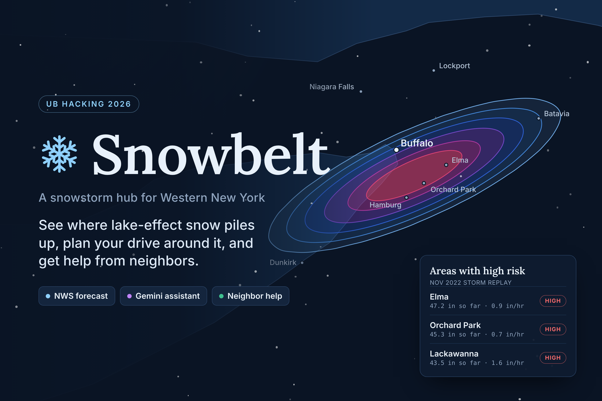
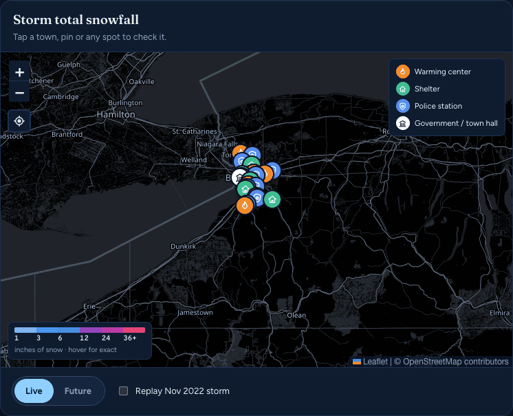
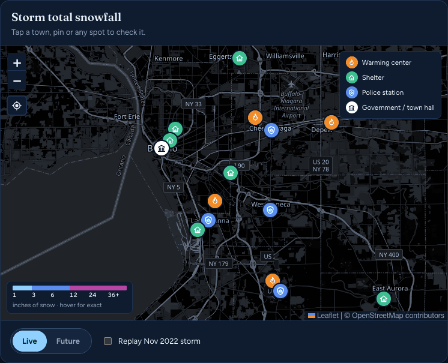
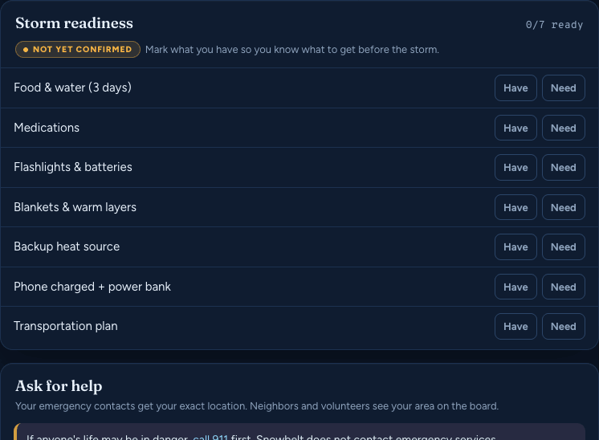
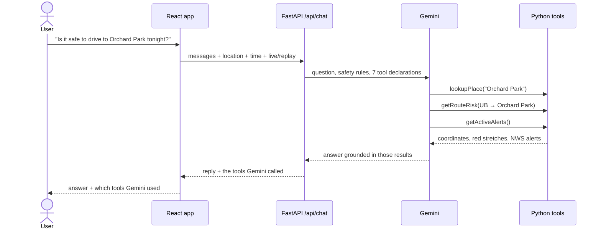
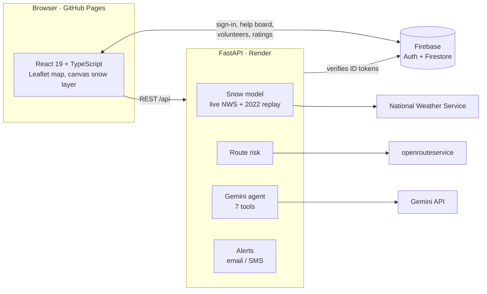

<p align="center">
  <a href="https://abereni4u.github.io/Snowbelt/"></a>
</p>

<p align="center">
  <a href="https://abereni4u.github.io/Snowbelt/"><b>Live demo</b></a> ·
  <a href="#features">Features</a> ·
  <a href="#how-gemini-does-the-real-work">How Gemini works</a> ·
  <a href="#architecture">Architecture</a> ·
  <a href="#run-it-locally">Run it locally</a> ·
  <a href="#roadmap">Roadmap</a>
</p>

<p align="center">
  <a href="https://github.com/abereni4u/Snowbelt/actions/workflows/ci.yml"></a>
  <a href="https://github.com/abereni4u/Snowbelt/actions/workflows/deploy-pages.yml"></a>
  
  
  
  
</p>

Lake-effect snow can bury one Buffalo neighborhood while the next one stays clear. **Snowbelt** shows where the snow is piling up across Western New York, tells you whether your drive crosses it, and connects you with neighbors and emergency contacts when you're stuck. A Gemini assistant does the heavy lifting: it looks up conditions, checks routes, finds shelters and drafts help requests from plain-language questions, using the same data the map shows.

Built in 24 hours at **UB Hacking 2026** (Gemini track) by a team of four.

> [!NOTE]
> The live demo runs on free tiers. The backend sleeps after 15 minutes idle, so the first visit can take up to a minute (the page says so while it wakes up). Gemini's free tier allows a limited number of requests per day; when they run out, the assistant says it's busy until the quota resets.

## Features

### Live snowfall map



- **Live NWS forecast:** snowfall sampled from the National Weather Service at 45 towns and blended across the region, refreshed every 30 minutes.
- **NWS-style bands** (1–3", 3–6", 6–12", 12–24", 24–36", 36"+) drawn as crisp outlines on a custom canvas layer, redrawn for every pan and zoom so edges stay sharp.
- **Hover anywhere** for the exact storm total and snowfall rate at that spot.
- **Look ahead:** slide or play through the next 24 hours.
- **November 2022 replay:** the historic Buffalo lake-effect storm, for seeing what a real event looks like.
- **Live NWS alerts** for all eight Western New York counties, plus a storm warning when your own location is about to get hit.

### Shelters, warming centers and police on the map



- Hover or tap a pin for its type, **distance in km**, status, address, phone, website and listed capacity.
- **Verified listings only:** Buffalo City Mission's Code Blue shelters, Buffalo City Hall and eight Erie County police departments, each with a `source_url`. Anything not yet verified is labeled **Sample** and says to call 2-1-1.
- **Locate button** under the zoom controls: asks the browser for your current position and flies the map there.

### A Gemini assistant that uses real tools

Ask "Is it safe to drive to Orchard Park tonight?" or "I'm snowed in and the heat is out". Gemini decides which of seven Python tools to call (conditions, high-risk areas, route risk, nearby resources, NWS alerts, place lookup, help-request drafts), the backend runs them, and Gemini answers from the results. Every answer lists the tools it used. It never sends an alert on its own: it can only fill in the help form for the person to confirm.

### Risk-aware routing

Pick a shelter or town and Snowbelt compares the **fastest** drive with a **safer** one. Real road routes come from openrouteservice; stretches through heavy snow are drawn in red, and the safer option avoids high-risk cells. During the 2022 replay, for example, the fastest drive from UB to Dunkirk runs along the lake through the worst snow, while the safer route goes inland.

### Storm readiness, neighbor help and volunteers



- **Readiness checklist** (food, medications, heat, power, transportation…) saved to your profile. When everything is ready, one tap tells your emergency contacts you're safe.
- **Get what you still need** three ways: request it from **your circle** (emails or texts your emergency contacts), from the **volunteer hub** (posts a supplies request on the neighbor board), or **ask Gemini** which shelters could help and how safe the drive is.
- **Ask for help:** alerts your emergency contacts with your exact location and posts to the neighbor board with a rounded one. Requests are sorted by urgency (medical first).
- **"I can help" with an ETA:** a neighbor claims a request and everyone sees it's covered. Unclaimed after 10 minutes, it points to the nearest shelter and 2-1-1. Afterwards the person helped can rate the helper.
- **Volunteer hub:** neighbors list their skills (4x4, snowblower, groceries runs, generator…). Ratings come only from people they actually helped, and volunteers whose skills match your readiness list are shown first.

## How Gemini does the real work



The google-genai SDK runs the function calls automatically (up to 8 per question). If the configured model is overloaded or out of quota, the backend falls back to the next Gemini model before giving up, and it always keeps the "call 911 first" guidance.

## Architecture



- **Every outside service is optional.** Without a key, Gemini, routing, live NWS, Firebase, email and SMS each fall back to sample data or a dry run, so the app always starts.
- **Contracts as tests:** every endpoint has an example request and response in `shared/contracts/`, and `pytest` fails when a response drifts from its example.
- **Firestore rules** (`firebase/firestore.rules`) enforce the community features server-side: you can only post as yourself, others can only claim an open request in their own name, and only the person helped can rate the helper.

| Layer | Tech |
| --- | --- |
| Frontend | React 19, TypeScript, Vite, Leaflet / react-leaflet, plain CSS |
| Backend | Python, FastAPI, Uvicorn, Pydantic, httpx |
| AI | Gemini via the google-genai SDK (automatic function calling) |
| Data | National Weather Service API, openrouteservice, OpenStreetMap tiles |
| Accounts and community | Firebase Auth (Google), Cloud Firestore, firebase-admin |
| Alerts | SMTP email, Twilio SMS |
| Hosting and CI | GitHub Pages (frontend), Render (backend), GitHub Actions (tests, build, deploy) |

## Safety by design

- **"Call 911 first"** appears wherever someone asks for help, and Gemini is instructed the same way. Snowbelt does not contact emergency services.
- **Gemini drafts, people send.** The assistant can fill in a help request but never sends one.
- **No invented places.** Every verified shelter, phone number and address has a `source_url`; anything unverified is labeled Sample.
- **Privacy:** neighbors see a location rounded to about a kilometer; only your own emergency contacts get the exact spot.
- **Abuse limits:** alerts are capped at 3 per person per 10 minutes, and the hosted demo has email and SMS turned off.
- **Fails closed:** if the server can't load its Firebase credentials, signed-in features return 503 instead of trusting anyone.

## Run it locally

You need Python 3.11+ and Node 20+.

```bash
# Backend (terminal 1)
cd backend
python3 -m venv .venv && source .venv/bin/activate     # Windows: py -m venv .venv, then .venv\Scripts\activate
pip install -r requirements-dev.txt
cp .env.example .env                                     # add whatever keys you have; blanks fall back safely
uvicorn app.main:app --reload --reload-dir app
```

```bash
# Frontend (terminal 2)
cd frontend
npm install
cp .env.example .env.local                               # Firebase web config, if you have one
npm run dev
```

Open http://localhost:5173. Vite forwards `/api` to the backend. http://localhost:8000/api/health shows which services are connected, and http://localhost:8000/docs lets you try every endpoint.

<details>
<summary><b>Configuration</b> (all optional)</summary>

| Setting | Where to get it | Goes in |
| --- | --- | --- |
| `GEMINI_API_KEY` | https://aistudio.google.com/apikey | `backend/.env` |
| `ORS_API_KEY` | https://openrouteservice.org (free) | `backend/.env` |
| `USE_LIVE_NWS` | No key needed; `false` uses the sample storm | `backend/.env` |
| `FIREBASE_CREDENTIALS` | Firebase console > Project settings > Service accounts (path to the JSON) | `backend/.env` |
| `SMTP_*`, `EMAIL_FROM` | Any SMTP account, e.g. Gmail with an app password | `backend/.env` |
| `TWILIO_*` | https://www.twilio.com | `backend/.env` |
| `VITE_FIREBASE_*` | Firebase console > Project settings > Your apps > Web app | `frontend/.env.local` |

Firebase also needs Google sign-in enabled, Firestore created, and `firebase/firestore.rules` published.

To give the volunteer hub something to show, `python -m scripts.seedTestVolunteers` (from `backend/`) adds five clearly marked test volunteers; `--remove` deletes them.

</details>

<details>
<summary><b>Tests and CI</b></summary>

```bash
cd backend && pytest          # offline API and contract tests, no keys needed
cd frontend && npm run build  # type-check and production build
```

GitHub Actions runs both on every pull request and push to `main`, then deploys the frontend.

</details>

<details>
<summary><b>Deploying</b></summary>

- **Frontend:** GitHub Pages, built and published by `.github/workflows/deploy-pages.yml` on every push to `main`. Set the repo variables `VITE_API_BASE` (the backend URL) and the four `VITE_FIREBASE_*` values, and choose **GitHub Actions** as the Pages source.
- **Backend:** Render's free plan from `render.yaml` (New > Blueprint). Enter `GEMINI_API_KEY` and `ORS_API_KEY` when asked, and add the service account as a Secret File named `firebase-service-account.json`.
- **Firebase:** add the Pages domain under Authentication > Settings > Authorized domains.

</details>

## API

Example requests and responses for every endpoint are in [`shared/contracts/`](shared/contracts/).

| Endpoint | Returns |
| --- | --- |
| `GET /api/risk?hours_ahead=0-24&mode=live\|replay` | Snow totals and rates on a ~3 km grid over Western New York |
| `GET /api/conditions?lat&lon&hours_ahead&mode` | Conditions at one point |
| `GET /api/areas?hours_ahead&mode` | Every town, worst first |
| `GET /api/alerts` | Live NWS alerts for the eight Western New York counties |
| `POST /api/route` | Fastest and safer routes, each with a risk level and red stretches |
| `GET /api/resources?lat&lon&type` | Nearest shelters, warming centers, police and government sites |
| `POST /api/help/notify` | Emails/texts the signed-in user's emergency contacts |
| `POST /api/chat` | Gemini's reply, the tools it called, and an optional help-request draft |
| `GET /api/health` | Which services are connected |

## Roadmap

- [ ] **Verify every listing:** replace the remaining sample warming centers with sourced ones, ideally from a 2-1-1 or county data feed, with live "Open" status.
- [ ] **Compare to past storms:** a Gemini tool that puts today's forecast next to Snowvember 2014 and the December 2022 blizzard.
- [ ] **Assistant evaluation:** a fixed set of real questions (drive, shelter, stuck, "wait or go now?") run against every prompt change.
- [ ] **Regions to avoid:** a map layer built from the high-risk cells, plus a close-up radar view with mile rings around your location.
- [ ] **Push notifications:** storm warnings and "help is on the way" updates through Firebase Cloud Messaging.
- [ ] **Works offline:** an installable PWA that keeps your checklist, contacts and nearest shelters during a power or data outage.
- [ ] **Volunteer verification:** ID checks, so trusted volunteers can be marked verified.
- [ ] **SMS alerts** through a production Twilio number.
- [ ] **Better replay data:** Open-Meteo historical weather for more storms, checked against NOHRSC snowfall analyses.
- [ ] **Beyond Western NY:** other lake-effect belts (Tug Hill, Erie PA, Michigan's snowbelts).

## Team

Built at UB Hacking 2026 by [abereni4u](https://github.com/abereni4u), [blacktea06](https://github.com/blacktea06), [EdCodez](https://github.com/EdCodez) and [Farhantdm556](https://github.com/Farhantdm556). [`CONTRIBUTING.md`](CONTRIBUTING.md) has our git routine and [`AGENTS.md`](AGENTS.md) the rules we gave our AI coding tools.

## Data sources

- [National Weather Service API](https://www.weather.gov/documentation/services-web-api): forecasts and alerts
- [openrouteservice](https://openrouteservice.org): driving routes
- [OpenStreetMap](https://www.openstreetmap.org/copyright): map tiles and Buffalo City Hall
- [Erie County / WNY Coalition for the Homeless](https://www4.erie.gov/exec/press/wny-coalition-homeless-announces-code-blue-25-26-season) and [Buffalo City Mission](https://www.buffalocitymission.org/contact): Code Blue shelters
- [Erie County DHSES](https://www3.erie.gov/dhses/local-police-and-fire-contacts-erie-county-ny): police department contacts

The demo GIFs are recorded from the running app by [`docs/media/recorder`](docs/media/recorder/).
